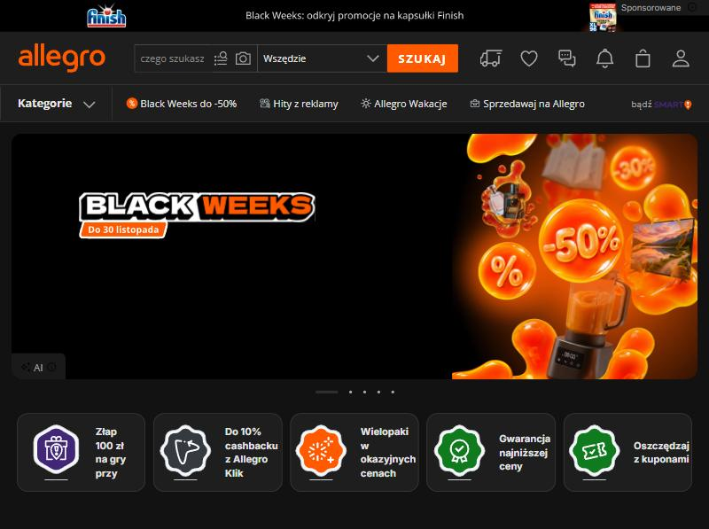
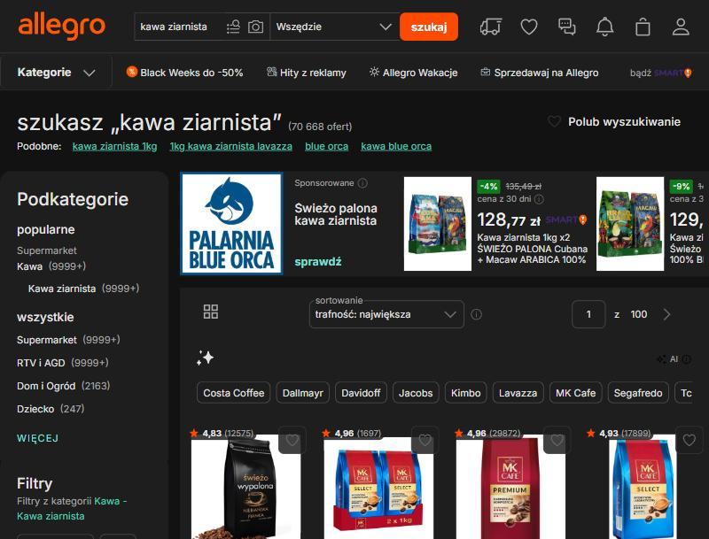
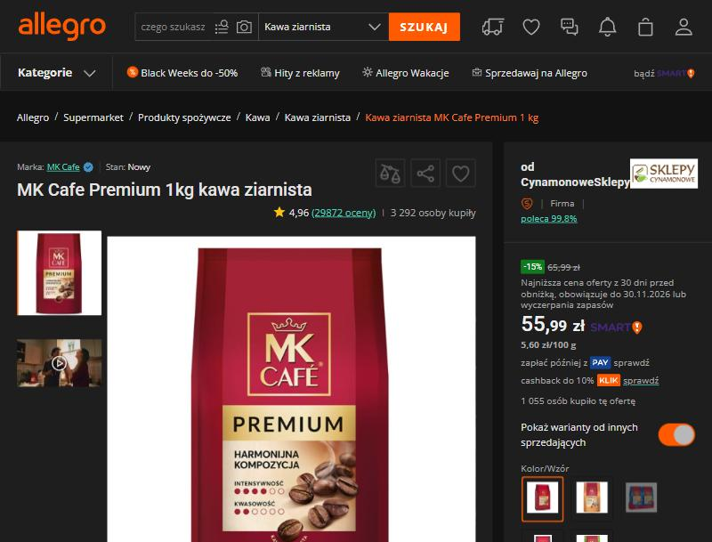
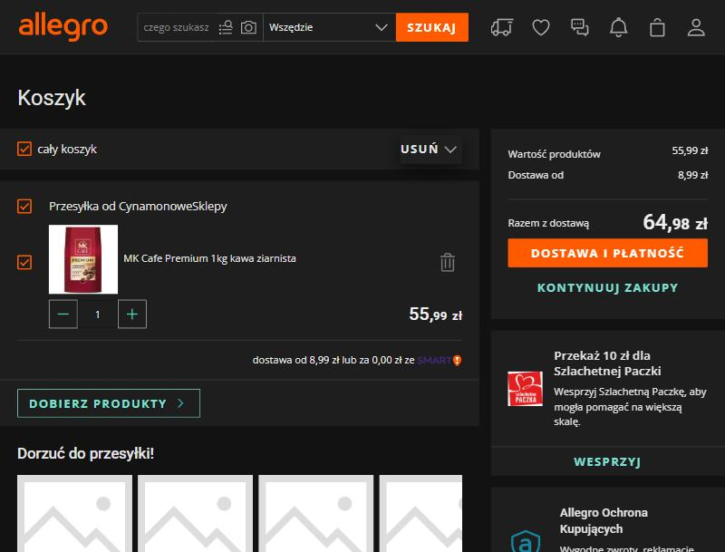
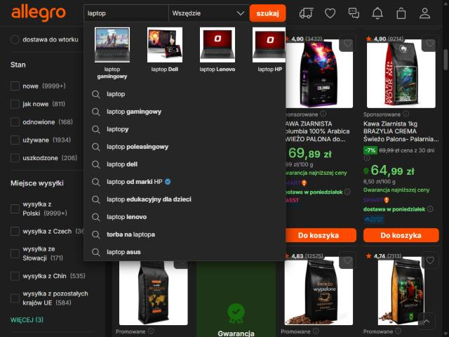

# Alledrogo — ciemny motyw dla Allegro

Rozszerzenie przeglądarki, które włącza **dark mode na Allegro.pl** i jego
subdomenach: stronie głównej, listingach, stronach ofert, koszyku,
Moim Allegro, wiadomościach i reszcie serwisu.

Motyw jest napisany ręcznie, bez globalnego `filter: invert()`. Zdjęcia
produktów, logotypy, wideo i kolorowe ikony zachowują oryginalne kolory.



## Funkcje

- **Ciemna paleta**: tło `#121212` / `#1e1e1e`, tekst `#e4e4e4`, akcenty
  w pomarańczowym kolorze Allegro (`#ff5a00`): fokus, zaznaczenie tekstu
  i przyciski główne.
- **Brak białego mignięcia** przy ładowaniu: skrypt i arkusz działają od
  `document_start`.
- **Obsługa SPA**: `MutationObserver` przemalowuje treści doładowywane
  dynamicznie (infinite scroll, modale, dropdowny, podpowiedzi wyszukiwarki).
- **Popup** z przełącznikiem ON/OFF. Stan zapisuje się w `chrome.storage.sync`,
  więc synchronizuje się między urządzeniami.
- **Tryb auto**: motyw działa tylko wtedy, gdy system ma ciemny motyw
  (`prefers-color-scheme: dark`), i przełącza się na żywo.
- Minimalne uprawnienia: tylko `storage` i host `*://*.allegro.pl/*`.
  Rozszerzenie nie zbiera i nie wysyła żadnych danych.

| Listing z filtrami | Strona oferty |
| --- | --- |
|  |  |

| Koszyk | Podpowiedzi wyszukiwarki |
| --- | --- |
|  |  |

## Instalacja (tryb deweloperski)

Najpierw pobierz kod:

```bash
git clone https://github.com/Harkryn/Alledrogo.git
```

Możesz też pobrać ZIP z GitHuba (**Code → Download ZIP**) i go rozpakować.

### Chrome, Edge, Brave, Opera

1. Otwórz stronę rozszerzeń:
   - Chrome: `chrome://extensions`
   - Edge: `edge://extensions`
   - Brave: `brave://extensions`
2. Włącz **Tryb dewelopera** (przełącznik w prawym górnym rogu, w Edge
   w lewym dolnym).
3. Kliknij **Załaduj rozpakowane** i wskaż folder `Alledrogo`
   (ten, w którym leży `manifest.json`).
4. Przypnij ikonę półksiężyca do paska narzędzi i odśwież otwarte karty Allegro.

### Firefox

**Tymczasowo (do testów, znika po restarcie przeglądarki):**

1. Otwórz `about:debugging#/runtime/this-firefox`.
2. Kliknij **Załaduj tymczasowy dodatek…** i wskaż plik `manifest.json`.

**Na stałe:** spakuj zawartość folderu do ZIP (np. `web-ext build`)
i podpisz paczkę w [AMO](https://addons.mozilla.org/developers/) jako
dodatek „nienotowany”. Alternatywnie w Firefox Developer Edition/Nightly
ustaw `xpinstall.signatures.required` na `false` w `about:config`.

> W Firefoksie uprawnienia do stron w MV3 przyznaje użytkownik. Jeśli motyw
> się nie włącza, kliknij ikonę puzzla na pasku, a potem przy Alledrogo
> wybierz **Zawsze zezwalaj na allegro.pl**.

Wymagany jest Firefox 115 lub nowszy.

## Jak to działa

```
manifest.json          MV3, content script na document_start, popup
styles/dark.css        cały motyw (aktywny tylko przy <html data-alledrogo="on">)
content/content.js     włączanie motywu, ustawienia, „malarz” + MutationObserver
popup/                 przełącznik ON/OFF i tryb auto
icons/                 ikony SVG + PNG 16/32/48/128
tools/make_icons.py    generator ikon PNG (czysty Python, bez zależności)
```

Allegro używa hashowanych nazw klas (np. `_1e32a_x8b2c`), które zmieniają się
przy każdym wdrożeniu, dlatego motyw z nich nie korzysta. Działa w trzech
warstwach:

1. **Tokeny design systemów Allegro.** Kolory serwisu pochodzą głównie
   z custom properties: Metrum (`--m-color-*`), Dune (`--semantic-color-*`)
   i typografii (`--textBody-color`, …). Arkusz nadpisuje je ciemnymi
   odpowiednikami, więc większość komponentów zmienia kolor „u źródła”.
2. **Stabilne selektory**: tagi semantyczne (`input`, `table`, `dialog`…),
   role i atrybuty ARIA (`[role="listbox"]`, `[role="option"][aria-selected]`,
   `[role="tooltip"]`…) oraz stany `:hover` i `:focus-visible`.
3. **„Malarz” w `content.js`.** Elementy, które mają jasne tło lub ciemny
   tekst wpisany na sztywno, skrypt wykrywa na podstawie **obliczonego stylu**
   (`getComputedStyle`), a nie nazw klas. Klasyfikuje kolor (biały / szary /
   pastelowy / ciemny tekst / nasycony tekst), oznacza element atrybutem
   `data-alledrogo-*` i arkusz go przemalowuje. Odcień pastelowych etykiet
   i kolorowego tekstu (np. zielone ceny) zostaje zachowany, zmienia się
   tylko jasność. Tekst na kolorowym lub obrazkowym tle (np. pomarańczowe
   przyciski) nie jest ruszany.

Ikony: inline SVG zmienia kolor tylko wtedy, gdy jest jednokolorowe i ciemne.
Ikonę `` jaśnieje tylko, jeśli to jednokolorowy glif Allegro
(np. `action-common-*.svg`, do 48 px). Zdjęcia, logotypy i ikony z kolorem
w nazwie nie są ruszane.

## Sprawdzone strony

| Strona | Wynik |
| --- | --- |
| Strona główna, baner zgód cookies, menu „Kategorie” | ✅ |
| Listing z filtrami, sortowaniem i chipami marek | ✅ |
| Podpowiedzi wyszukiwarki (dropdown) | ✅ |
| Strona oferty: galeria, parametry, opis, opinie, zestawy | ✅ |
| Koszyk: lista, menu „Usuń”, modal potwierdzenia | ✅ |
| Moje Allegro, wiadomości (czat), zamówienia | ⚠️ nietestowane (wymagają zalogowania) |

## Znane ograniczenia

- **Zdjęcia produktów mają zwykle białe tło**, więc na ciemnej stronie
  wyglądają jak jasne prostokąty. To celowe: rozszerzenie nie zmienia
  kolorów zdjęć.
- **Ciemne logotypy na przezroczystym tle** (np. część logo marek w menu
  kategorii czy logo sprzedawców) mogą być słabo widoczne. Rozszerzenie nie
  potrafi bezpiecznie odróżnić ich od zwykłych zdjęć.
- **Opisy ofert w HTML sprzedawcy** mogą mieć własne, sztywne kolory
  (np. czarny tekst na białej tabeli). Malarz przemalowuje większość z nich,
  ale grafiki wklejone przez sprzedawcę zostają bez zmian.
- **Strony wymagające logowania** (Moje Allegro, czat z kupującym
  i sprzedającym, sprzedaż) nie były testowane. Powinny działać dzięki
  tokenom i malarzowi, ale mogą mieć pojedyncze jasne elementy. Zgłoś je
  w Issues ze zrzutem ekranu.
- **Krótkie mignięcie przy pierwszym uruchomieniu**: decyzja o włączeniu
  motywu jest zapamiętywana w `localStorage` strony, więc działa bez zwłoki
  od drugiego wczytania. Przy pierwszej wizycie po instalacji motyw jest
  domyślnie włączony.
- **Elementy w Shadow DOM i ramki z innych domen** (np. bramki płatności,
  widgety reklamowe) nie są obsługiwane.
- Allegro często zmienia front-end, więc pojedyncze elementy mogą
  przejściowo wyglądać źle.

## Licencja

[MIT](LICENSE)
